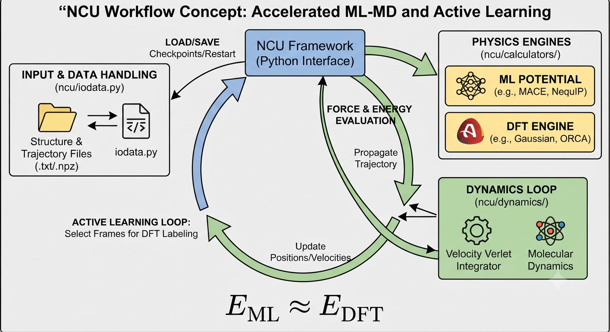

# NCU

A personal research toolkit for running Machine Learning Molecular Dynamics (ML-MD) workflows without rewriting complete code every time I switch DFT packages or ML potentials.



## Why I'm Building This

When running atomistic simulations, moving data between DFT codes (like Gaussian, ORCA), and then for continuing adiabatic process I need to do MD and again through that result (position) do new DFT and again MD loop and accordingly we will get PES. I'm building **NCU** to keep everything under one clean Python interface so I can easily swap calculators, save checkpoints, and customize active-learning loops for my own systems.


## Planned Code Layout

I'm organizing the code around a common `BaseCalculator` interface so the MD loop doesn't care whether forces come from a DFT run or a trained neural network:

```text
NCU/
├── ncu/
│   ├── iodata.py              # Reading/writing NumPy checkpoints (.npz) & text arrays
│   ├── calculators/
│   │   ├── base.py            # BaseCalculator class (energy & force interface)
│   │   ├── dft.py             # Wrappers/parsers for DFT engines
│  
│   ├── dynamics/
│   │   ├── integrator.py      # Velocity  thermostats
│   │   └── simulation.py      # Main MD loop + periodic checkpoint saving
│   └── workflows/
│       └── active_learning.py # Flag high-uncertainty frames -> DFT -> retrain
├── LICENSE
└── README.md
